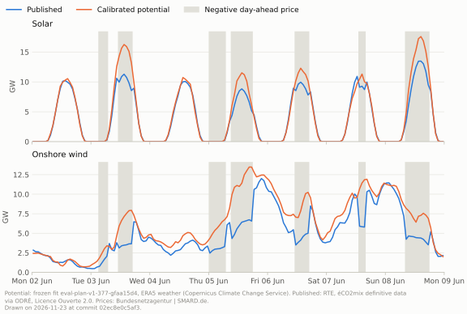
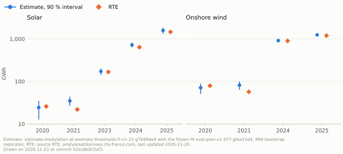

# eu-solar-wind-audit

[](https://github.com/zkyasin/eu-solar-wind-audit/actions/workflows/ci.yml)

Checks how comparable published solar and wind production data are across Europe, against a
weather-based reference.

Transmission system operators and data platforms publish hourly solar and wind output. The series
differ in what they cover, they contain errors, and part of the output is held back when prices
turn negative. This project models the output each fleet could have produced from ERA5 weather and
the installed capacity, calibrates the model on hours with normal prices, and uses it as a
reference to answer four questions per country:

1. How closely does the model follow the published output?
2. Where are the published series wrong: gaps, shifted hours, impossible values, breaks in level?
3. What does each published series contain: self-consumption, distribution grids?
4. How much output was held back during negative prices?

The validation rules were written before the first result, in the
[evaluation plan](docs/evaluation-plan.md) (tag `eval-plan-v1`). Every later change is listed with
its date and reason in the plan's Deviations section.

## Status

| Axis | Mainland France | Germany |
|---|---|---|
| 1. Model quality | Calibrated on 2019-2025 | Calibrated on 2019-2025 |
| 2. Anomalies | All detectors, 2019-2025 | All detectors, 2019-2025 |
| 3. Content of the series | Next | Next |
| 4. Modulation at negative prices | Estimated and compared with RTE | Estimated and compared with Hirth (2026) |

The Netherlands and Denmark follow, then Belgium, Spain, Portugal, Italy, Austria and Poland, each
published with the level of evidence the plan allows.

## Results, 2019-2025

### A week with negative prices in mainland France

<picture>
  <source media="(prefers-color-scheme: dark)" srcset="docs/figures/week-dark.svg">
  
</picture>

The calibrated potential is fitted only on hours priced 5 €/MWh or more and never sees the shaded
hours. At the hours of this week with a negative price (45 for wind, 36 of them in daylight for
solar), published onshore wind was 52 % of its potential and solar 76 %: an estimated 172 GWh and
96 GWh held back.

### Model quality

Hourly error of the potential of each year, fitted on the other years, over hours priced 5 €/MWh
or more. RMSE in capacity factor, 2023-2025:

| Model | France, solar | France, onshore wind | Germany, solar | Germany, onshore wind |
|---|---|---|---|---|
| Physics model, nominal parameters | 0.085 | 0.089 | 0.094 | 0.098 |
| Climatology by month and hour | 0.078 | 0.161 | 0.070 | 0.146 |
| Calibrated potential | 0.035 | 0.031 | 0.040 | 0.027 |
| With stratum ratios and annual level | 0.031 | 0.028 | 0.025 | 0.024 |

The hourly correlation of the last model is 0.986 for both French technologies, 0.981 for German
solar and 0.988 for German onshore wind. French onshore wind leaves out 2023, when the published
wind series includes offshore output. Germany is calibrated on the feed-in that SMARD publishes,
which leaves out self-consumed output; its frozen fits are in `fits/DE` (tag `calibration-de-v1`).

Without its annual level, the potential fitted on the other years gives the published output of
each year to within 10 %, except German solar since 2023. Published output over that potential:

| Year | France, solar | Germany, solar | Germany, onshore wind |
|---|---|---|---|
| 2019 | 1.03 | 1.06 | 1.04 |
| 2020 | 0.98 | 1.07 | 1.03 |
| 2021 | 0.91 | 1.01 | 1.01 |
| 2022 | 0.96 | 1.04 | 1.01 |
| 2023 | 1.04 | 0.90 | 1.00 |
| 2024 | 0.98 | 0.85 | 0.97 |
| 2025 | 1.00 | 0.79 | 0.98 |

German solar feed-in fell from 1.01 to 1.07 times its potential in 2019-2022 to 0.79 in 2025.
Over the same years, French solar production, which includes self-consumption, stayed between 0.91
and 1.04, and German wind, which has none, between 0.97 and 1.04. A growing share of self-consumed
solar output is the first candidate; axis 3 tests it.

### Anomalies in the published series

Every hourly solar and wind series of mainland France (national and 12 regions, éCO2mix) and
Germany (national and four control areas, SMARD, with Energy-Charts as a second source) goes
through rule-based detectors, and through statistical detectors on its residual against the model
of its area, with thresholds fixed on 2019-2022 (tags `anomaly-thresholds-fr-v1` and
`anomaly-thresholds-de-v1`). The 2019-2025 runs give 194 findings in France and 110 in Germany. The
cases checked against the raw files are written as tickets in
[docs/anomalies-2019-2025.md](docs/anomalies-2019-2025.md), among them:

- éCO2mix: the half-hour ending at midnight on 31 December 2025 is empty in all 26 solar and wind
  series (FR-1).
- Grand Est solar, 30 June 2025: 2.4 times the modelled output, about 20 GWh, carried into the
  national total (FR-3).
- Nouvelle-Aquitaine wind, January 2023: 231 GWh published for about 414 GWh expected (FR-4).
- Île-de-France wind above the SDES capacity from 2022 to 2025, up to 1.14 times (FR-5).
- SMARD: Amprion solar at about 50 MWh an hour at night from 12 June to 14 July 2025 (DE-3).
- SMARD: TransnetBW solar published as zero from 16:00 to 20:00 on 12 April 2019, a hole of about
  3 GWh that the national total carries too, so that only the model shows it (DE-4).

<picture>
  <source media="(prefers-color-scheme: dark)" srcset="docs/figures/sum-of-parts-dark.svg">
  
</picture>

The solar feed-in that SMARD publishes for Germany matches the sum of its four control areas to
within 10 MWh a day on every day of 2025 but two periods, both found by the detector: August, when
the national total is below the sum (DE-2), and 3 to 10 December, when TransnetBW is published as
zero while the national total keeps its output, up to 15.5 GWh a day (DE-1).

### Output modulated during negative prices in mainland France

The estimate M̂ is the sum, over the hours with a negative day-ahead price, of the calibrated
potential minus the published output. RTE publishes monthly volumes of its own. Its method is not
public, so agreement replicates its figures without proving either.

<picture>
  <source media="(prefers-color-scheme: dark)" srcset="docs/figures/modulation-dark.svg">
  
</picture>

| Year | Solar M̂, GWh (90 % interval) | RTE | Onshore wind M̂, GWh (90 % interval) | RTE |
|---|---|---|---|---|
| 2020 | 24.4 (12.7 to 35.1) | 25.9 | 71.3 (50.9 to 89.4) | 79.0 |
| 2021 | 34.8 (26.4 to 44.0) | 22.0 | 81.5 (63.6 to 99.9) | 57.1 |
| 2023 | 172.5 (142.4 to 200.7) | 167.4 | no onshore series | 376.8 |
| 2024 | 722.5 (634.2 to 817.3) | 639.2 | 914.5 (833.3 to 998.9) | 894.9 |
| 2025 | 1,581.4 (1,320.1 to 1,842.0) | 1,461.2 | 1,247.5 (1,146.8 to 1,341.1) | 1,197.1 |

Under the rules of the plan, both technologies are *concordant in volume only*. The ratios M̂ / RTE
of 2024 and 2025 lie within [0.8, 1.25]: 1.13 and 1.08 for solar, 1.02 and 1.04 for onshore wind.
The monthly tests fail. The placebo, hours priced 5 to 15 €/MWh, misses the ±2 % the plan asks:
there, published solar exceeds the potential by 1.4 to 4.6 % in five years of six, so the solar
estimate may be too low by a few percent of the potential. The intervals, the verdict and the
limits are in [docs/modulation-france.md](docs/modulation-france.md).

### Output modulated during negative prices in Germany

The same estimate for Germany sets its yearly volumes beside the market-based curtailment of Hirth
(2026), without a verdict, as the plan says. The share of the onshore wind potential held back at
negative prices is within 3 points of his curtailment rate each year from 2022 (15 to 25 %), and
the volumes are 79 to 90 % of his, which also hold offshore wind. Solar in 2025 is 2.4 times his
0.6 TWh: the estimate keeps grid-related curtailment, and the feed-in that SMARD publishes falls
when home batteries and self-consumption take the midday output. Details in
[docs/modulation-germany.md](docs/modulation-germany.md).

## How it works

- **Physics model.** ERA5 hourly weather on its 0.25° grid. Solar output comes from pvlib, on the
  capacity of each département (SDES) or Kreis (Marktstammdatenregister), as a mix of systems by
  orientation and tilt with a DC/AC ratio. Onshore wind comes from turbine power curves by
  commissioning period, at their hub height.
- **Calibrated potential.** Three parameters for solar and one for onshore wind, a scale on wind
  speed, fitted with a Huber loss on the hours priced 5 €/MWh or more, leaving one year out; then
  a ratio for each stratum of solar elevation, decile of the modelled capacity factor and day type,
  shrunk towards the pooled ratio, and a level for each year. The fits are frozen in `fits/FR` and
  `fits/DE` (tags `calibration-fr-v1` and `calibration-de-v1`), and a test checks that the
  calibration never reads the reference series.
- **Anomaly detectors.** Completeness, timestamp shifts, negative, frozen and above-capacity
  values, outliers of the residual, level breaks (PELT), totals against the sum of their parts and
  against a second source.
- **Modulation.** Signed sums over the negative-price hours; 90 % intervals from a stationary
  bootstrap of days that refits the calibration and draws the capacity and the DC/AC ratio; a
  minimal detectable effect; a placebo on low positive prices and an injection-recovery test.

## Reproduce

Python 3.12 and [uv](https://docs.astral.sh/uv/). No account is needed: ERA5 comes from two
anonymous cloud copies, the other sources from their public interfaces. Downloads are cached under
`data/raw`, about 3 GB of ERA5 for France and 1.7 GB for Germany over 2019-2025.

```sh
uv sync
# Model quality, leaving one year out; --fits-dir keeps the frozen fits of fits/ unchanged.
uv run eu-solar-wind-audit calibrate FR solar data/processed/calibration-fr --fits-dir data/processed/fits-fr
uv run eu-solar-wind-audit calibrate FR wind_onshore data/processed/calibration-fr --fits-dir data/processed/fits-fr
uv run eu-solar-wind-audit calibrate DE solar data/processed/calibration-de --fits-dir data/processed/fits-de
uv run eu-solar-wind-audit calibrate DE wind_onshore data/processed/calibration-de --fits-dir data/processed/fits-de
# Modulation, with the frozen fits and the references of references/rte and references/hirth.
uv run eu-solar-wind-audit estimate-modulation FR solar data/processed/modulation-fr
uv run eu-solar-wind-audit estimate-modulation FR wind_onshore data/processed/modulation-fr
uv run eu-solar-wind-audit estimate-modulation DE solar data/processed/modulation-de
uv run eu-solar-wind-audit estimate-modulation DE wind_onshore data/processed/modulation-de
# Anomalies, with the frozen thresholds of config/anomaly-thresholds.
uv run eu-solar-wind-audit detect-anomalies FR 2019-01-01 2026-01-01 data/processed/anomalies-fr
uv run eu-solar-wind-audit detect-anomalies DE 2019-01-01 2026-01-01 data/processed/anomalies-de
# The figures of this page.
uv run eu-solar-wind-audit draw-figures docs/figures
```

Each command records the version of the code and of its inputs in a JSON file beside its tables,
and each figure in its footer. The checks and the workflow are in
[CONTRIBUTING.md](CONTRIBUTING.md).

## Real-time archive

RTE later replaces the éCO2mix real-time values with consolidated data. A scheduled workflow saves
the national real-time export from ODRÉ once a day and attaches it to the monthly release
`realtime-YYYY-MM`, with its retrieval time and SHA-256 checksum.

## Data and licences

The code is under the [MIT licence](LICENSE). Each data source keeps its own licence;
[docs/data-licences.md](docs/data-licences.md) gives the terms of each and what may be republished.
The results on this page use:

```text
France: RTE, éCO2mix data via ODRÉ, Licence Ouverte 2.0, retrieved on 22 and 23 November 2026.
France, negative-price modulation: source RTE, analysesetdonnees.rte-france.com, last updated 20 November 2026.
Service des données et études statistiques (SDES), quarterly solar and wind capacity tables.
Germany: Bundesnetzagentur | SMARD.de, CC BY 4.0.
Germany, unit register: Bundesnetzagentur, Marktstammdatenregister, dl-de/by-2-0 (www.govdata.de/dl-de/by-2-0), export of 2026-10-01; data changed.
Germany, administrative boundaries: © BKG (2026) dl-de/by-2-0 (Daten verändert).
Germany, market-based curtailment: Hirth, L. (2026), Do wind and solar curtail at negative electricity prices?, arXiv 2609.10053v2.
Energy-Charts.info, Fraunhofer ISE, CC BY 4.0.
Contains modified Copernicus Climate Change Service information 2026. Neither the European Commission nor ECMWF is responsible for any use that may be made of the Copernicus information or data it contains.
ERA5 accessed through Icechunk ERA5 (Earthmover), https://registry.opendata.aws/earthmover-era5, CC BY 4.0, and ARCO-ERA5 (Google Research).
Turbine power curves: NREL turbine-models, Copyright (c) 2020 Alliance for Sustainable Energy, LLC, BSD 3-Clause.
Made with Natural Earth.
```
