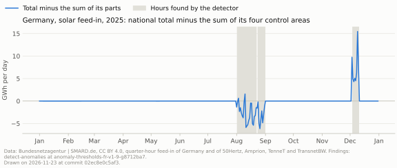

# eu-solar-wind-audit

[](https://github.com/zkyasin/eu-solar-wind-audit/actions/workflows/ci.yml)

Checks how comparable published solar and wind production data are across Europe, against a
weather-based reference.

Results online: [zkyasin.github.io/eu-solar-wind-audit](https://zkyasin.github.io/eu-solar-wind-audit/).

Transmission system operators and data platforms publish hourly solar and wind output. The series
differ in what they cover, they contain errors, and part of the output is held back when prices
turn negative. This project models the output each fleet could have produced from ERA5 weather and
the installed capacity, calibrates the model on hours with normal prices, and uses it as a
reference to answer four questions per country:

1. How closely does the model follow the published output?
2. Where are the published series wrong: gaps, shifted hours, impossible values, breaks in level?
3. What does each published series contain: self-consumption, distribution grids?
4. How much output was held back during negative prices?

The validation rules were written before the first result, in the
[evaluation plan](docs/evaluation-plan.md) (tag `eval-plan-v1`). Every later change is listed with
its date and reason in the plan's Deviations section.

## Main results

Solar and onshore wind in mainland France, Germany and the two Danish price areas, and onshore
wind in the Netherlands, 2019-2025:

1. **Model.** Fitted on the other years, the hourly potential of each year follows the published
   output with an error of 0.024 to 0.031 in capacity factor and a correlation of 0.98 to 0.99 in
   France and Germany, of 0.041 to 0.060 and 0.96 to 0.98 in the smaller Danish price areas, and
   of 0.042 and 0.98 for the Dutch onshore wind of the transmission grid (2023-2025, hours priced
   5 €/MWh or more).
2. **Anomalies.** 194 findings in France, 110 in Germany, 21 in Denmark and 4 in the
   Netherlands. Among those checked against the raw files: an empty half-hour in all 26 éCO2mix
   solar and wind series, a German control area published as zero for more than a week while the
   national total kept its output, a Danish estimate of self-consumed solar output two hours early
   for two months of 2020, and Dutch solar published as zero for 68 hours of February 2019.
3. **Content.** SMARD, feed-in only, and Energy-Charts total power, which adds self-consumption,
   land in the cells their producers state, and so do the two Danish series of Energinet, with
   and without its self-consumption estimate. French self-consumption, 1 to 7 % of solar output,
   is too small for yearly statistics to confirm.
4. **Negative prices.** Mainland France held back an estimated 1.58 TWh of solar output in 2025
   (90 % interval 1.32 to 1.84) and 1.25 TWh of onshore wind (1.15 to 1.34), where RTE publishes
   1.46 and 1.20 TWh. The yearly volumes agree; the monthly tests of the plan fail. DK1, which
   has no published reference, held back an estimated 42 % of its solar potential at
   negative-price hours in 2025, 0.30 TWh (0.27 to 0.32).

## Status

| Axis | Mainland France | Germany | Denmark (DK1, DK2) | Netherlands |
|---|---|---|---|---|
| 1. Model quality | Calibrated on 2019-2025 | Calibrated on 2019-2025 | Calibrated on 2019-2025 per price area | Onshore wind calibrated on 2019-2025 |
| 2. Anomalies | All detectors, 2019-2025 | All detectors, 2019-2025 | All detectors, 2019-2025 | Rule-based on all series, statistical on onshore wind, 2019-2025 |
| 3. Content of the series | Distribution grids covered; self-consumption inconclusive | SMARD feed-in only; Energy-Charts total complete | Size classes feed-in only; with self-consumption complete | Transmission grid only |
| 4. Modulation at negative prices | Estimated and compared with RTE | Estimated and compared with Hirth (2026) | Estimated, no reference; published above the detectable effect | Onshore wind estimated, no reference; inconclusive every year |

Belgium, Spain, Portugal, Italy, Austria and Poland follow, each published with the level of
evidence the plan allows.

## Results, 2019-2025

### A week with negative prices in mainland France

<picture>
  <source media="(prefers-color-scheme: dark)" srcset="docs/figures/week-dark.svg">
  
</picture>

The calibrated potential is fitted only on hours priced 5 €/MWh or more and never sees the shaded
hours. At the hours of this week with a negative price (45 for wind, 36 of them in daylight for
solar), published onshore wind was 52 % of its potential and solar 76 %: an estimated 172 GWh and
96 GWh held back.

### Model quality

Hourly error of the potential of each year, fitted on the other years, over hours priced 5 €/MWh
or more. RMSE in capacity factor, 2023-2025:

| Series | Physics model, nominal parameters | Climatology by month and hour | Calibrated potential | With stratum ratios and annual level | Correlation of the last model |
|---|---|---|---|---|---|
| France, solar | 0.085 | 0.078 | 0.035 | 0.031 | 0.986 |
| France, onshore wind | 0.089 | 0.161 | 0.031 | 0.028 | 0.986 |
| Germany, solar | 0.094 | 0.070 | 0.040 | 0.025 | 0.981 |
| Germany, onshore wind | 0.098 | 0.146 | 0.027 | 0.024 | 0.988 |
| DK1, solar | 0.077 | 0.113 | 0.062 | 0.056 | 0.963 |
| DK1, onshore wind | 0.123 | 0.202 | 0.045 | 0.041 | 0.981 |
| DK2, solar | 0.091 | 0.110 | 0.064 | 0.060 | 0.957 |
| DK2, onshore wind | 0.176 | 0.205 | 0.050 | 0.047 | 0.975 |
| Netherlands, onshore wind | 0.140 | 0.197 | 0.050 | 0.042 | 0.978 |

French onshore wind leaves out 2023, when the published wind series includes offshore output.
Germany is calibrated on the feed-in that SMARD publishes, which leaves out self-consumed output;
its frozen fits are in `fits/DE` (tag `calibration-de-v1`). Each Danish price area is calibrated on
its settlement data, solar with its self-consumed part; the frozen fits are in `fits/DK1` and
`fits/DK2` (tag `calibration-dk-v1`). The Danish errors are 1.5 to 2.4 times those of France and
Germany, most likely because a smaller fleet averages out less of the local weather that ERA5
misses at 0.25°. Dutch onshore wind is calibrated on the series of the NL zone on the ENTSO-E
Transparency Platform, which holds the farms of the transmission grid only: its capacity is that
of CBS times 0.486, the share of the CBS output that the series holds over 2019-2022, and the
capacity factors are counted on it (plan, Deviations). The frozen fit is in `fits/NL` (tag
`calibration-nl-v1`).

Without its annual level, the potential fitted on the other years gives the published output of
each year to within 10 %, except German solar since 2023. Published output over that potential:

| Year | France, solar | Germany, solar | Germany, onshore wind |
|---|---|---|---|
| 2019 | 1.03 | 1.06 | 1.04 |
| 2020 | 0.98 | 1.07 | 1.03 |
| 2021 | 0.91 | 1.01 | 1.01 |
| 2022 | 0.96 | 1.04 | 1.01 |
| 2023 | 1.04 | 0.90 | 1.00 |
| 2024 | 0.98 | 0.85 | 0.97 |
| 2025 | 1.00 | 0.79 | 0.98 |

German solar feed-in fell from 1.01 to 1.07 times its potential in 2019-2022 to 0.79 in 2025.
Over the same years, French solar production, which includes self-consumption, stayed between 0.91
and 1.04, and German wind, which has none, between 0.97 and 1.04. A growing share of self-consumed
solar output is the first candidate: axis 3 confirms that the SMARD feed-in leaves it out, and
Fraunhofer ISE puts it at 6 % of German solar output in 2019 and 22 % in 2025.

### Anomalies in the published series

Every hourly solar and wind series of mainland France (national and 12 regions, éCO2mix),
Germany (national and four control areas, SMARD, with Energy-Charts as a second source), the
Danish price areas (Energinet settlement data) and the Netherlands (ENTSO-E Transparency Platform)
goes through rule-based detectors, and through statistical detectors on its residual against the
model of its area, with thresholds fixed on 2019-2022 (tags `anomaly-thresholds-fr-v1`,
`anomaly-thresholds-de-v1`, `anomaly-thresholds-dk-v1` and `anomaly-thresholds-nl-v1`). The
2019-2025 runs give 194 findings in France, 110 in Germany, 13 in DK1, 8 in DK2 and 4 in the
Netherlands. The cases checked against the raw files are written as tickets in
[docs/anomalies-2019-2025.md](docs/anomalies-2019-2025.md), among them:

- éCO2mix: the half-hour ending at midnight on 31 December 2025 is empty in all 26 solar and wind
  series (FR-1).
- Grand Est solar, 30 June 2025: 2.4 times the modelled output, about 20 GWh, carried into the
  national total (FR-3).
- Nouvelle-Aquitaine wind, January 2023: 231 GWh published for about 414 GWh expected (FR-4).
- Île-de-France wind above the SDES capacity from 2022 to 2025, up to 1.14 times (FR-5).
- SMARD: Amprion solar at about 50 MWh an hour at night from 12 June to 14 July 2025 (DE-3).
- SMARD: TransnetBW solar published as zero from 16:00 to 20:00 on 12 April 2019, a hole of about
  3 GWh that the national total carries too, so that only the model shows it (DE-4).
- Energinet: solar published as zero in both price areas from 13:00 to 19:00 on 17 August 2019,
  where the Transparency Platform repeats one value (DK-1).
- Energinet: the self-consumed solar output that Energinet estimates runs about two hours early
  from 17 June to 14 August 2020, and its negative afternoon values cancel the metered output
  (DK-2).
- Transparency Platform: Dutch solar published as zero for 68 hours from 4 to 7 February 2019,
  through two days of daylight without snow (NL-2).

<picture>
  <source media="(prefers-color-scheme: dark)" srcset="docs/figures/sum-of-parts-dark.svg">
  
</picture>

The solar feed-in that SMARD publishes for Germany matches the sum of its four control areas to
within 10 MWh a day on every day of 2025 but two periods, both found by the detector: August, when
the national total is below the sum (DE-2), and 3 to 10 December, when TransnetBW is published as
zero while the national total keeps its output, up to 15.5 GWh a day (DE-1).

### What the published series contain

Each series is placed in the matrix of the plan from two types of evidence that must agree: its
yearly level against Eurostat gross production, solar against wind, and what its producer states,
quoted in `references/documentation`. A self-consumed share of solar output is detected from
9.1 %, a share of wind capacity left out from 4.1 %.

| Series | Self-consumption | Distribution grids | Cell |
|---|---|---|---|
| SMARD, Germany | Excluded, decided on 2022-2024 | Covered | Feed-in only |
| Energy-Charts total power, Germany | Included, decided on 2022-2024 | Covered | Complete |
| éCO2mix, mainland France | Inconclusive: 1.0 % to 7.1 % of solar output | Covered | Inconclusive |
| Energinet size classes, Denmark | Excluded, decided on 2020-2024 | Covered | Feed-in only |
| Energinet with self-consumption, Denmark | Included, decided on 2020-2024 | Covered | Complete |
| Transparency Platform, Netherlands | Inconclusive: no published share | Inconclusive: not covered by its level, no statement of its producer | Inconclusive |

The two German series share their fleet and weather and land in different cells, as their
producers state, and so do the two Danish ones. RTE counts self-consumption in its production
figures, but the French share is too small for yearly statistics to confirm it. The Dutch series
of the Transparency Platform has 59 % to 69 % of Eurostat's wind output and 1 % to 4 % of its
solar output, and its level is decided as not covering the distribution grids in every year. No
statement of TenneT, its producer, is archived to confirm it, and the plan publishes no other
country until this validation case passes.

Two more types of evidence each fail a control. Self-consumption barely depends on the sky, so a
feed-in series should rise more than the modelled output from overcast to clear days. Against the
physics model, SMARD does the opposite (−0.035, 90 % interval −0.054 to −0.016), and the French
contrast, expected at zero, runs from −0.062 in winter to +0.061 in summer. A load net of
self-consumption should fall as the modelled output rises within the day. The SMARD load does
(−0.071 MWh per MWh), but so does French consumption, which includes self-consumption (−0.085),
from −0.25 in winter to +0.08 in summer: lighting, heating and cooling follow the sun too. Both
tests are reported and not used. Details in
[docs/perimeter-2019-2024.md](docs/perimeter-2019-2024.md).

### Output modulated during negative prices in mainland France

The estimate M̂ is the sum, over the hours with a negative day-ahead price, of the calibrated
potential minus the published output. RTE publishes monthly volumes of its own. Its method is not
public, so agreement replicates its figures without proving either.

<picture>
  <source media="(prefers-color-scheme: dark)" srcset="docs/figures/modulation-dark.svg">
  
</picture>

| Year | Solar M̂, GWh (90 % interval) | RTE | Onshore wind M̂, GWh (90 % interval) | RTE |
|---|---|---|---|---|
| 2020 | 24.4 (12.7 to 35.1) | 25.9 | 71.3 (50.9 to 89.4) | 79.0 |
| 2021 | 34.8 (26.4 to 44.0) | 22.0 | 81.5 (63.6 to 99.9) | 57.1 |
| 2023 | 172.5 (142.4 to 200.7) | 167.4 | no onshore series | 376.8 |
| 2024 | 722.5 (634.2 to 817.3) | 639.2 | 914.5 (833.3 to 998.9) | 894.9 |
| 2025 | 1,581.4 (1,320.1 to 1,842.0) | 1,461.2 | 1,247.5 (1,146.8 to 1,341.1) | 1,197.1 |

Under the rules of the plan, both technologies are *concordant in volume only*. The ratios M̂ / RTE
of 2024 and 2025 lie within [0.8, 1.25]: 1.13 and 1.08 for solar, 1.02 and 1.04 for onshore wind.
The monthly tests fail. The placebo, hours priced 5 to 15 €/MWh, misses the ±2 % the plan asks:
there, published solar exceeds the potential by 1.4 to 4.6 % in five years of six, so the solar
estimate may be too low by a few percent of the potential. The intervals, the verdict and the
limits are in [docs/modulation-france.md](docs/modulation-france.md).

### Output modulated during negative prices in Germany

The same estimate for Germany sets its yearly volumes beside the market-based curtailment of Hirth
(2026), without a verdict, as the plan says. The share of the onshore wind potential held back at
negative prices is within 3 points of his curtailment rate each year from 2022 (15 to 25 %), and
the volumes are 79 to 90 % of his, which also hold offshore wind. Solar in 2025 is 2.4 times his
0.6 TWh: the estimate keeps grid-related curtailment, and the feed-in that SMARD publishes falls
when home batteries and self-consumption take the midday output. Details in
[docs/modulation-germany.md](docs/modulation-germany.md).

### Output modulated during negative prices in Denmark

No published volume of Danish modulation exists, so the estimates of the two price areas carry no
reference and count only where they reach their minimal detectable effect. DK1 solar holds back
22 % of its potential at the negative-price hours of 2023, 28 % in 2024 and 42 % in 2025, about
0.3 TWh that year (90 % interval 0.27 to 0.32 TWh); DK1 onshore wind holds back 22 to 26 % in
2023-2025. DK2 reaches its detectable effect for solar in 2025 and onshore wind in 2024 only.
Details in [docs/modulation-denmark.md](docs/modulation-denmark.md).

### Output modulated during negative prices in the Netherlands

Dutch onshore wind of the transmission grid holds back an estimated 16 % of its potential at the
negative-price hours of 2023, 17 % in 2024 and 23 % in 2025, 135 GWh that year (90 % interval 117
to 154 GWh). No published volume exists, and no year reaches its minimal detectable effect, so
under the plan every estimate is inconclusive. The detectable effect is set by a few calm days
whose potential is near zero; without them it would fall below the estimates, but the rule is the
one fixed for all countries. Details in
[docs/modulation-netherlands.md](docs/modulation-netherlands.md).

## How it works

- **Physics model.** ERA5 hourly weather on its 0.25° grid. Solar output comes from pvlib, on the
  capacity of each département (SDES), Kreis (Marktstammdatenregister) or Danish municipality
  (Energi Data Service, and the register of the Danish Energy Agency for wind), as a mix of systems
  by orientation and tilt with a DC/AC ratio. Onshore wind comes from turbine power curves by
  commissioning period, at their hub height; in the Netherlands, by hub height class (CBS), on
  the capacity of each province spread over municipalities by the turbine map of RIVM.
- **Calibrated potential.** Three parameters for solar and one for onshore wind, a scale on wind
  speed, fitted with a Huber loss on the hours priced 5 €/MWh or more, leaving one year out; then
  a ratio for each stratum of solar elevation, decile of the modelled capacity factor and day type,
  shrunk towards the pooled ratio, and a level for each year. The fits are frozen in `fits/FR`,
  `fits/DE`, `fits/DK1`, `fits/DK2` and `fits/NL` (tags `calibration-fr-v1`,
  `calibration-de-v1`, `calibration-dk-v1` and `calibration-nl-v1`), and a test checks that the
  calibration never reads the reference series.
- **Anomaly detectors.** Completeness, timestamp shifts, negative, frozen and above-capacity
  values, outliers of the residual, level breaks (PELT), totals against the sum of their parts and
  against a second source.
- **Content of the series.** Yearly published output against Eurostat gross production, solar
  against wind, with a detection threshold from the error measured on the series whose content is
  known, combined with what each producer states. Two signatures are tested against a negative
  and a positive control: the rise of published over modelled solar output from overcast to clear
  days within cells of fixed hour and calendar, and the fall of the load as the modelled output
  rises, with effects of the day and of the hour and calendar.
- **Modulation.** Signed sums over the negative-price hours; 90 % intervals from a stationary
  bootstrap of days that refits the calibration and draws the capacity and the DC/AC ratio; a
  minimal detectable effect; a placebo on low positive prices and an injection-recovery test.
- **R recomputation.** `R/recompute.R` recomputes the monthly modulation sums and refits both
  signatures with fixest from the tables that Python writes. On the 2019-2025 results the largest
  relative difference is about 1e-15 for the sums and 3e-11 for the coefficients and standard
  errors, against the 1e-6 and 1e-3 that the plan allows. CI runs the comparison on synthetic
  data.

## Reproduce

Python 3.12 and [uv](https://docs.astral.sh/uv/). ERA5 comes from two anonymous cloud copies, the
other sources from their public interfaces; the audit of axis 3 and the Netherlands need a free
token of the ENTSO-E Transparency Platform, in `ENTSOE_API_TOKEN`. Downloads are cached under
`data/raw`, about 3 GB of ERA5 for France, 1.7 GB for Germany, 0.7 GB for Denmark and 0.3 GB for
the Netherlands over 2019-2025.

```sh
uv sync
# Model quality, leaving one year out; --fits-dir keeps the frozen fits of fits/ unchanged.
uv run eu-solar-wind-audit calibrate FR solar data/processed/calibration-fr --fits-dir data/processed/fits-fr
uv run eu-solar-wind-audit calibrate FR wind_onshore data/processed/calibration-fr --fits-dir data/processed/fits-fr
uv run eu-solar-wind-audit calibrate DE solar data/processed/calibration-de --fits-dir data/processed/fits-de
uv run eu-solar-wind-audit calibrate DE wind_onshore data/processed/calibration-de --fits-dir data/processed/fits-de
uv run eu-solar-wind-audit calibrate DK1 solar data/processed/calibration-dk1 --fits-dir data/processed/fits-dk1
uv run eu-solar-wind-audit calibrate DK1 wind_onshore data/processed/calibration-dk1 --fits-dir data/processed/fits-dk1
uv run eu-solar-wind-audit calibrate DK2 solar data/processed/calibration-dk2 --fits-dir data/processed/fits-dk2
uv run eu-solar-wind-audit calibrate DK2 wind_onshore data/processed/calibration-dk2 --fits-dir data/processed/fits-dk2
ENTSOE_API_TOKEN=... uv run eu-solar-wind-audit calibrate NL wind_onshore data/processed/calibration-nl --fits-dir data/processed/fits-nl
# Modulation, with the frozen fits and the references of references/rte and references/hirth.
uv run eu-solar-wind-audit estimate-modulation FR solar data/processed/modulation-fr
uv run eu-solar-wind-audit estimate-modulation FR wind_onshore data/processed/modulation-fr
uv run eu-solar-wind-audit estimate-modulation DE solar data/processed/modulation-de
uv run eu-solar-wind-audit estimate-modulation DE wind_onshore data/processed/modulation-de
uv run eu-solar-wind-audit estimate-modulation DK1 solar data/processed/modulation-dk1
uv run eu-solar-wind-audit estimate-modulation DK1 wind_onshore data/processed/modulation-dk1
uv run eu-solar-wind-audit estimate-modulation DK2 solar data/processed/modulation-dk2
uv run eu-solar-wind-audit estimate-modulation DK2 wind_onshore data/processed/modulation-dk2
ENTSOE_API_TOKEN=... uv run eu-solar-wind-audit estimate-modulation NL wind_onshore data/processed/modulation-nl
# Anomalies, with the frozen thresholds of config/anomaly-thresholds.
uv run eu-solar-wind-audit detect-anomalies FR 2019-01-01 2026-01-01 data/processed/anomalies-fr
uv run eu-solar-wind-audit detect-anomalies DE 2019-01-01 2026-01-01 data/processed/anomalies-de
ENTSOE_API_TOKEN=... uv run eu-solar-wind-audit detect-anomalies NL 2019-01-01 2026-01-01 data/processed/anomalies-nl
# What the published series contain, against Eurostat, references/sdes and references/documentation.
ENTSOE_API_TOKEN=... uv run eu-solar-wind-audit audit-perimeter data/processed/perimeter
# The feed-in and consumption signatures, from the solar predictions of calibrate.
uv run eu-solar-wind-audit feed-in-signature data/processed/signature
uv run eu-solar-wind-audit consumption-signature data/processed/signature
# The same statistics recomputed in R, with the packages fixest, jsonlite and nanoparquet.
Rscript R/recompute.R --modulation data/processed/modulation-fr --modulation data/processed/modulation-de --signature data/processed/signature --output data/processed/r-recomputation.json
# The figures of this page.
uv run eu-solar-wind-audit draw-figures docs/figures
# The data of the web page: daily output and potential, model quality, modulation, findings and
# the matrix of axis 3, in site/data.
uv run eu-solar-wind-audit export-site-data site/data
```

Each command records the version of the code and of its inputs in a JSON file beside its tables,
and each figure in its footer. The checks and the workflow are in
[CONTRIBUTING.md](CONTRIBUTING.md).

## Real-time archive

RTE later replaces the éCO2mix real-time values with consolidated data. A scheduled workflow saves
the national real-time export from ODRÉ once a day and attaches it to the monthly release
`realtime-YYYY-MM`, with its retrieval time and SHA-256 checksum.

## Data and licences

The code is under the [MIT licence](LICENSE). Each data source keeps its own licence;
[docs/data-licences.md](docs/data-licences.md) gives the terms of each and what may be republished.
The results on this page use:

```text
France: RTE, éCO2mix data via ODRÉ, Licence Ouverte 2.0, retrieved on 22 and 23 November 2026.
France, negative-price modulation: source RTE, analysesetdonnees.rte-france.com, last updated 20 November 2026.
Service des données et études statistiques (SDES), quarterly solar and wind capacity tables; L'autoconsommation d'électricité en France, 2 October 2026.
France, national register of production installations at the end of 2024: RTE, Enedis, EDF SEI and local distribution operators, via ODRÉ, Licence Ouverte 2.0.
Germany: Bundesnetzagentur | SMARD.de, CC BY 4.0.
Germany, unit register: Bundesnetzagentur, Marktstammdatenregister, dl-de/by-2-0 (www.govdata.de/dl-de/by-2-0), export of 2026-10-01; data changed.
Germany, administrative boundaries: © BKG (2026) dl-de/by-2-0 (Daten verändert).
Germany, market-based curtailment: Hirth, L. (2026), Do wind and solar curtail at negative electricity prices?, arXiv 2609.10053v2.
Energy-Charts.info, Fraunhofer ISE, CC BY 4.0.
Source: Energinet (www.energidataservice.dk). CC BY 4.0.
Source of publication: ENTSO-E Transparency Platform (transparency.entsoe.eu). Values shown are derived from the published data.
Source: Eurostat, nrg_bal_peh (doi.org/10.2908/NRG_BAL_PEH), accessed on 24 November 2026. Data modified by this project; Eurostat is not responsible for the modified data.
Contains modified Copernicus Climate Change Service information 2026. Neither the European Commission nor ECMWF is responsible for any use that may be made of the Copernicus information or data it contains.
ERA5 accessed through Icechunk ERA5 (Earthmover), https://registry.opendata.aws/earthmover-era5, CC BY 4.0, and ARCO-ERA5 (Google Research).
Turbine power curves: NREL turbine-models, Copyright (c) 2020 Alliance for Sustainable Energy, LLC, BSD 3-Clause.
Made with Natural Earth.
```
